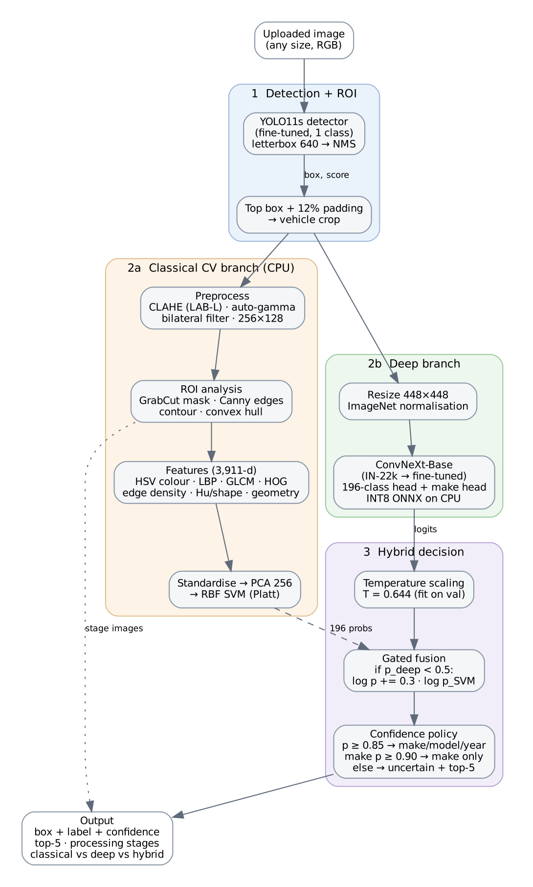

# Design Document: Intelligent Fine-Grained Vehicle Recognition (P5)

## 1. Problem and constraints

Find the vehicle, draw its bounding box, name make/model/year (196 classes Stanford Cars)
with a confidence score, on a real-world photo.
Classical CV + deep learning, dealing with visually similar classes, varying illumination,
occlusions, viewpoint, resolution, low-confidence flag, classical vs deep vs hybrid
comparison, hosted web app.

Constraint | Consequence on design
---|---
196 fine-grained classes, ~41 training images/class | Transfer learning on large pre-trained backbone, strong regularisation
Classes vary by year, trim, badge | High input resolution (448 px) tight crop on car
One annotated box per image, no other labels | Single class detector, no plate reading or tracking (not in scope of brief)
Free CPU hosting (2 vCPU) | ONNX Runtime, INT8 quantization, no PyTorch in deployed app
Honest evaluation | Separate validation split from train for any tuning decision, test once

## 2. Architecture

Cascade: **detect → crop → classify (2 branches) → calibrated decision**

1. **Detection + ROI.** YOLO11s, fine-tuned on Stanford Cars as a single "car" class. Most
   confident box. Pad 12% on each side of the box (so bumpers, mirrors, wheel arches are in
   view) and crop.
2a. **Classical branch.** Normalise the crop (CLAHE on L-channel of LAB, auto gamma,
   bilateral filter). Resize 256×128. GrabCut with detection box as seed, segments car from
   background. Compute Canny edges, largest contour, its convex hull.
   7 feature groups (3911 dimensions): HSV colour histograms inside the mask, uniform LBP on 2×2
   grid, GLCM/Haralick texture, HOG, edge density on 4×4 grid, contour shape (solidity, extent,
   elongation, circularity, Hu moments), box geometry (aspect ratio, area share).
   Standardise, PCA-reduce (256), RBF SVM classification with Platt probabilities.
2b. **Deep branch.** Fine-tuned ConvNeXt-Base (ImageNet-22k pre-trained) on 448×448 crops,
   196-way head, auxiliary 49-way manufacturer head. INT8 ONNX deployed.
3. **Hybrid decision.** Deep logits divided by temperature fitted on validation. If
   calibrated deep confidence < 0.5, add SVM log-probabilities with weight 0.3 (gate/weight on
   validation). Then decide what to answer with a 3-level policy.

## 3. Data

* Kaggle mirror of Stanford Cars. CSV annotations, images in class folders.
  `src/data/prepare.py` creates a single index of all 16185 images with box, image size, parsed
  labels.
* **Labels.** Year = last token of class name. Make = first token or known multi-word make
  (AM General, Aston Martin, Land Rover). Model = the rest. Coarse body type (sedan, SUV,
  pickup, ...) derived for analysis. 49 makes.
* **Splits.** Train 6922 / validation 1222 (stratified 15% of official train set, seed 42) /
  test 8041 (official test set). Hyper-parameters, checkpoint, temperature, fusion weight,
  thresholds all selected on validation. Test only for reporting.

## 4. Components & design decisions

### 4.1 Detector: YOLO11s fine-tuned, single class
* 30 epochs, 640 px, AMP, cosine LR, early stopping. ~23 min on RTX 4070.
* **Why fine-tune.** COCO model fires on every vehicle in the scene (5.8 boxes/image on test
  set). Often picks a background car. Fine-tuning makes it understand that the annotated car
  is the main subject. mAP@0.5:0.95 0.821 → **0.937**, mean IoU 0.886 → **0.954**. Same size, speed.
* **Why it's enough.** Substituting YOLO boxes with ground-truth boxes changes classification
  top-1 by −0.01 points. No bottleneck in detector.

### 4.2 Classical branch
* **Why these features.** They map 1-to-1 to the mandatory classical components in the brief:
  preprocessing/normalisation, edges/contours, colour/texture, ROI extraction (GrabCut),
  geometry.
* **GrabCut with detection box as seed.** Gives foreground mask without any training. Colour
  histograms, contour shape computed inside the mask. Excludes background clutter (brick
  walls, floor tiles, other cars) which dominates the raw Canny map.
* **Result.** 9.58% top-1, 28.3% top-5. 19× chance. HOG contains most of the signal (8.22%
  alone). Colour, texture, shape, geometry together: 1.37%, but they add 1.4 points on top of
  HOG. Colour is almost useless for identity (any model comes in any colour).

### 4.3 Deep branch: ConvNeXt-Base @448 on crops
* **Backbone.** ConvNeXt-Base pre-trained on ImageNet-22k (`timm`). Strong transfer to
  fine-grained tasks. Convolutional, good for quantization.
* **Resolution 448.** Badges, grilles, lamp shapes are small. Higher resolution than usual 224
  helps fine-grained recognition (see ablation).
* **Training on crops.** Ground-truth crops during train, detector crops at test.
* **Regularisation for ~41 images/class.** Label smoothing 0.1, CutMix/MixUp (p = 0.5),
  RandAugment, colour jitter, random erasing, drop-path 0.1. AdamW with 10× higher LR on heads.
  2-epoch warm-up, cosine decay. bf16, gradient accumulation (effective batch 32).
* **Auxiliary make head (weight 0.3).** Hierarchical supervision: shared features should also
  separate manufacturers. Helps with many same-make confusions. Probabilities also help with
  make-level fallback.
* **Result.** Best validation top-1: 95.09% (epoch ~24/30). Test end-to-end: **94.89% top-1,
  99.50% top-5, 98.63% make**.

### 4.4 Hybrid integration
The brief requests integration of classical and deep, not just side-by-side.
They're integrated at 3 points:
1. **Cascade.** Detector ROI drives both branches. GrabCut seeded with the detected box.
2. **Score fusion, gated.** Log-linear fusion `log p = log p_deep(T) + w · gate · log p_SVM`.
   Weight and gate chosen by **validation negative log-likelihood** (proper scoring rule).
   Noise-only change in top-1 accuracy on 1222 images. A random stand-in for the SVM got 0.16
   points of top-1 on validation but correctly rejected by NLL. Selected: w = 0.3, only if
   deep confidence < 0.5 (1.8% of images).
3. **Calibrated confidence handling.** Raw model is *under*-confident (ECE 0.144). Known side
   effect of label smoothing and mixing. Temperature scaling (T = 0.644, fitted on
   validation) yields test ECE **0.016**. Hybrid: **0.015**. Calibrated confidences make
   thresholds meaningful.

**Low-confidence policy** (thresholds chosen on validation for ≥ 97% accuracy on answered images):

Calibrated confidence | Answer | Test share | Test accuracy
---|---|---|---
class ≥ 0.85 | make + model + year | 91.2% | 97.6%
else make ≥ 0.90 (sum of classes for that make) | manufacturer only | 4.2% | 99.7%
otherwise | "uncertain" + top-5 shown | 4.6% | true class in top-5: 90.3%

**What the fusion adds (honest).** The SVM is right on only 41/411 test errors of ConvNeXt.
Never confidently. Gated fusion slightly improves calibration (ECE 0.0162 → 0.0151).
Accuracy-neutral (−0.05 points, 4 images, within noise). Hybrid value is in the cascade, the
calibrated decision policy, not adding classical scores. Tested classical CLAHE in front of
CNN under bad lighting: no gain (±0.2 points). CNN learned lighting invariance from colour
jitter, RandAugment.

### 4.5 Optimisation for deployment
* ONNX export (opset 17). **Dynamic INT8 quantization** on all MatMul/Gemm weights.
  ConvNeXt: pointwise MLP layers (most parameters).
* On CPU, 2 threads (free Hugging Face tier): **335 → 95 MB (3.5× smaller), 541 → 216 ms (2.5×
  faster), same top-1** on 500 test crops (94.8% → 95.2%, within noise).
* Mixed precision on GPU: train/inference bf16 (21.9 ms/image @ batch 1).
* Detector also exported to ONNX (38 ms on 2 CPU threads). No PyTorch needed in deployed app.
  ONNX Runtime + OpenCV + scikit-learn only.

### 4.6 Application
Streamlit app (`app/streamlit_app.py`). Live at https://vehicle-recognition-standfordcardataset-team-altf4.streamlit.app/
(Streamlit Community Cloud, free CPU). **Identify a car** tab shows:
* annotated image. Box coloured by confidence level: green full answer, orange make only, red
  uncertain. Other detected vehicles in grey.
* Verdict, timings per stage
* Calibrated top-5
* Classical vs deep vs hybrid comparison per image
* 7 classical processing stages: ROI crop, CLAHE, gamma + bilateral, Canny, GrabCut mask,
  foreground, contour + convex hull.

Decision thresholds fixed at values selected on validation (85% full answer, 90%
manufacturer only). Shown as markers on confidence bars in result card. **How well it works**
tab: test set comparison, detector/optimisation tables, calibration/robustness plots.
**How it works**: pipeline, limitations.

## 5. Results summary
Full tables: [`eval_P5_T60.md`](../eval_P5_T60.md). Ablations: [`docs/ablation_study.md`](ablation_study.md).

Approach (test, 8041 images) | Top-1 | Top-5 | ECE | Size | Latency
---|---|---|---|---|---
Classical (features + SVM) | 9.58% | 28.27% | 0.042 | 38.5 MB | 332 ms (CPU, 1 core)
Deep (ConvNeXt-Base @448) | 94.89% | 99.50% | 0.144 | 335 MB | 21.9 ms (GPU) / 216 ms INT8 CPU
**Hybrid (deployed)** | **94.84%** | **99.47%** | **0.015** | 95 MB INT8 + 39 MB | ~28 ms (GPU, expected)
Deep ensemble (crop + full image model) | **95.50%** | 99.61% | 0.143 (0.016 calibrated) | 2 × 335 MB | 2 × 22 ms (GPU)

**Best accuracy: 2-model ensemble.** A second ConvNeXt-Base trained on full images (95.01%)
has largely different errors from the crop model (300/400 shared). Probability average:
95.50% top-1 on test. Only adopted after it also beat the single model on validation
(95.42% vs 95.09%). Deployed app has the single crop model. Half size, half CPU time.
Important for free CPU hosting.

Detector (test) | Mean IoU | mAP@0.5 | mAP@0.5:0.95
---|---|---|---
YOLO11s fine-tuned | 0.954 | 0.990 | 0.937
YOLO11s COCO zero-shot | 0.886 | 0.887 | 0.821

**Robustness** (4000 test images):
* Illumination changes (gamma 0.45/2.2, brightness ±40%): max 0.3 points
* Low light + sensor noise: 2.5. 25% occlusion: 2.8
* Blur (σ=2): 8.5. 128 px resolution: 8.0
* Model breaks at 50% occlusion (78.7%), 64 px (37.5%)
* Hardest: front/rear views (92.9%). Easiest: 3/4 views (95.6%).
* Detector maintains IoU ≥ 0.5 on ≥ 97.8% of images for all corruptions except 50% occlusion
  (53.8%).

## 6. Ablation highlights
* **ROI crop.** Removing it: −0.83 points top-1. Worse calibration (ECE 0.143 → 0.177). Oracle
  detector: nothing (−0.01).
* **Detector fine-tuning.** +11.6 points mAP@0.5:0.95 vs zero-shot.
* **Temperature scaling.** ECE 0.144 → 0.016. Identical accuracy.
* **Fusion.** ECE 0.0162 → 0.0151. Top-1 −0.05 (neutral).
* **Flip TTA.** −0.17. Cars not left/right symmetric (badges, fuel caps, steering side). Not
  used.
* **Classical feature groups.** HOG alone: 8.22%. All non-HOG groups: 1.37%. Together: 9.58%.
* **Resolution 224 vs 448, make head on/off, training on full images.** See
  `docs/ablation_study.md`.

## 7. Limitations & future work
* **Closed set.** Only 196 classes known (mostly 1991–2012, US market). Newer/unlisted car
  maps to nearest class. Many, but not all, flagged by confidence policy. Open-set
  detection (e.g. energy scores, "unknown" class trained on outside images) would help.
* **One car per image.** Most confident box. Multi-car scenes: only 1 car classified.
* **Near-identical siblings** (Silverado 1500 vs 2500HD, Express Van vs Cargo Van, rebadged
  Chevrolet/GMC vans) main error source. See `failure_analysis.md`. Higher resolution part
  crops (grille, badge) or attention-cropping methods would be natural next step.
* **Low resolution/heavy occlusion.** Training with downscaling, larger occlusion
  augmentation would help at 64–128 px, 50% occlusion.

## 8. Reproduction
1 command per step. See `README.md`. Fixed seeds (42). Per-epoch logs in `runs/`. Metrics
JSON in `results/metrics/`. npz contract, evaluation harness in `src/eval/evaluate.py`.