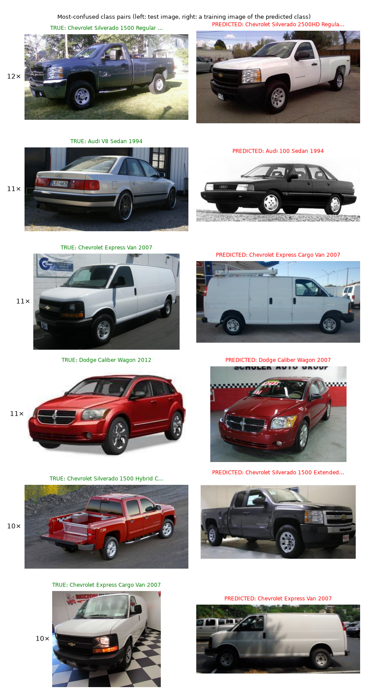
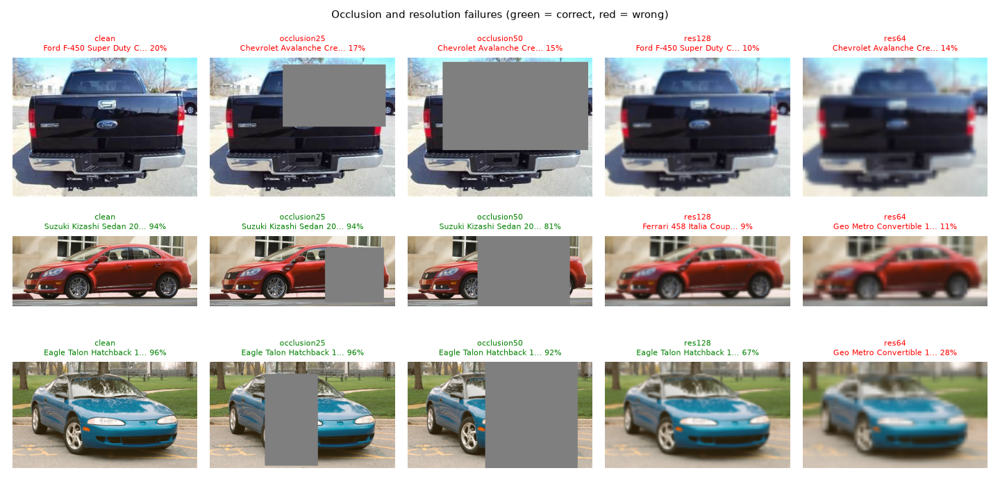
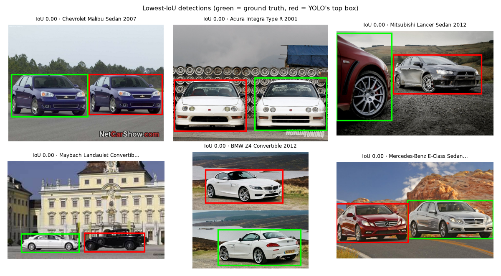
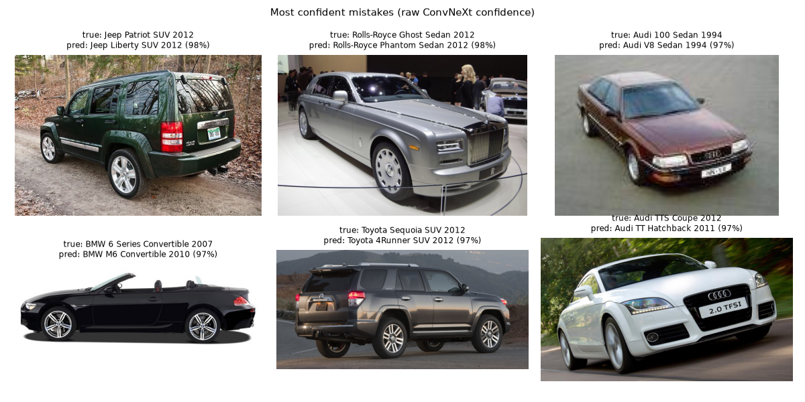
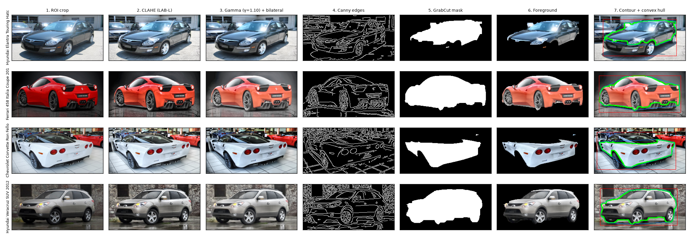

# Failure cases

Numbers from the official test split (8041 unseen images), end-to-end: YOLO crop then
ConvNeXt-Base. The deployed system makes **411 errors (5.1%)**. Figures generated with
`python -m src.eval.failure_cases` in `results/failures/`.

## Where the errors come from

| Error type | Count | Share of errors |
| --- | --- | --- |
| Wrong class, **same manufacturer** | 301 | 73% |
| Same model name, **only different year** | 31 | 8% |
| Different manufacturer | 110 | 27% |
| Wrong answer with raw confidence >= 0.85 | 64 | 16% |
| Detector box on wrong object (IoU < 0.5) | 14 images | 0.17% of test |

Most errors are not random. They are near siblings that are distinct according to the dataset labels but
hardly distinct by pixels.

## Failure 1: Near-identical sibling classes (trim/cab/body variations)

| True class | Predicted as | Test images |
| --- | --- | --- |
| Chevrolet Silverado 1500 Regular Cab 2012 | Silverado 2500HD Regular Cab 2012 | 12 |
| Chevrolet Express Van 2007 | Express Cargo Van 2007 | 11 (+10 the other way) |
| Chevrolet Silverado 1500 Hybrid Crew Cab 2012 | Silverado 1500 Extended Cab 2012 | 10 |
| Chevrolet Express Van 2007 | GMC Savana Van 2012 | 8 |

**Cause.**
* **Same body, different trim.** These classes share the same sheet metal. The 1500 and 2500HD have
different suspension height, wheel bolt pattern, small badges.
* **Same van, different glazing.** Passenger/cargo Express differ mostly in side windows, which
are not visible from the front or rear.
* **Same van, different badge.** GMC Savana is a rebadged Chevrolet Express: the only difference is
the grille and logo.
* **Labels encode trim, not appearance.** If the distinguishing feature is not visible from the
viewpoint of the photo, then the image doesn't actually have the answer.
* **Viewpoint matters.** Front/rear views, where the cab length/glazing are hidden, are the
hardest overall viewpoint (92.9% vs 95.6% for three-quarter views).

**Handling.** This is precisely the case the confidence policy is designed for. The two candidates
will divide probability. Calibrated confidence will be lower. We fall back to the manufacturer, which
is correct as long as both candidates share it (all the pairs in the table, except the
Chevrolet/GMC twins), or we show the top-5, which includes the true class.
**Fix:** higher-res part crops (badge, grille, rear lamps) or attention-based part localisation.

## Failure 2: Year variants of the same model (facelifts)

31 errors of right make and model but wrong year, e.g. **Dodge Caliber Wagon 2012 -> 2007 (11
images)**.

**Cause.**
* **Facelifts are just details**: grille insert, headlamp internals, bumper shape, interior. From
three-quarter/side views the 2007 and 2012 cars are almost identical.
* **Few images per year class (~40)**: there isn't much evidence for such subtle differences.

**Handling and fix.** Fallback to the make level keeps the answer correct at the manufacturer
level. A coarse-to-fine model (predict make+model, then year from high-res front crop) would
address this directly.

## Failure 3: Performance/badge variants within a make

Audi **S5 Coupe -> A5 Coupe**, **TTS Coupe -> TT Hatchback**, **V8 Sedan -> 100 Sedan** (1994), BMW
**6 Series Convertible -> M6 Convertible**.

**Cause.**
* **Body shell is the same as the base car.** The performance model differs mainly in bumpers,
wheel design, exhaust tips, "S"/"M" badge.
* **Small cues are lost at the working resolution.** These details are a few pixels wide at 448
px when the car fills a large photo.
* **Same platform, little visual difference.** The 1994 Audi V8 and 100 share the platform and
have almost no exterior difference.

**Fix.** Same as Failure 1: part-level crops, or more aggressive zoom augmentation on badges/wheels
during training.

## Failure 4: Heavy occlusion

| Occluded area (random grey block) | Top-1 | Detector IoU >= 0.5 |
| --- | --- | --- |
| 0% | 94.9% | 99.6% |
| 10% | 94.4% | - |
| 25% | 92.2% | 93.2% |
| 50% | **78.7%** | **53.8%** |

**Cause.**
* **Classifier loses parts that distinguish siblings.** At 50% occlusion, the block often covers
the grille, headlamps, tail lamps. This is precisely the parts that distinguish sibling classes
(Failures 1-3).
* **Detector fails too.** It shrinks its box to the visible half or splits the car into two boxes.
So the crop itself is wrong.

Random erasing during training (up to 20% of the crop) explains the graceful behaviour up to 25%.
**Fix:** larger erasing during training, and detector fine-tuned with occlusion augmentation.

## Failure 5: Low resolution

| Long side of the car crop | Top-1 | Mean confidence |
| --- | --- | --- |
| original (usually 300-1500 px) | 94.9% | 0.955 |
| 224 px | 93.2% | 0.923 |
| 128 px | 86.9% | 0.820 |
| 64 px | **37.5%** | 0.502 |

**Cause.** The model works at 448 px. Discriminative details (badges, lamp shapes) vanish below
~128 px. At 64 px, there is little more than body type/colour. Confidence decreases with accuracy
(0.50 at 64 px). So most of these cases are flagged as uncertain, rather than wrong answer with
high confidence. The detector still finds the car (97.8% IoU >= 0.5 at 64 px).
**Fix:** downscale augmentation during training, or super-resolution pre-step.

## Failure 6: Wrong car in multi-car scenes (detector)

Only 14 of 8041 test images (0.17%) have a box with IoU < 0.5. 6 of them have IoU ~ 0: the box is on
**different object**.

**Cause.**
* **One annotation per image.** Stanford Cars labels one car per photo. In a dealership lot/street
scene with multiple cars, the most confident box from the detector can be a different/larger/sharper
car than the annotated one.
* **Unusual framings** (cropped bodies, reflections, heavily cluttered backgrounds) result in
partial boxes.

Now the pipeline classifies the wrong car. **Handling:** the app draws all detected vehicles (grey)
next to the chosen one. So the user can see the ambiguity. **Fix:** let the user choose the box, or
classify every detection.

## Failure 7: Confident errors, cars outside the 196 classes

64 errors with raw confidence >= 0.85. After calibration, still ~2.4% of accepted answers
(confidence >= 0.85) are wrong.

**Cause.**
* **Look-alike pairs.** Most are the sibling/look-alike pairs above: a whole class is very similar
to another.
* **Out-of-distribution cars.** This is a closed-set dataset (mostly 1991-2012 US-market cars). A
2020 model or a car sold only in India doesn't have a correct label. Yet, the softmax still needs to
choose one of the 196 classes. Sometimes with high confidence.

**Fix.** Out-of-distribution detection (energy score, or additional "unknown" class trained on
outside images). This limitation is stated on the app's About tab.

## Failure 8 (classical branch): segmentation/edge clutter

* **GrabCut fails on low contrast cars.** White/silver cars on bright backgrounds can drop the
wheels/lower body (their colour stats are similar to the background). This distorts the shape
features of the contour.
* **Raw Canny is dominated by the background** (brick walls, floor tiles, other cars). This is why
we only compute shape features inside the GrabCut mask.
* **Features can't encode identity well.** HOG captures the silhouette, but the classes differ
in details that hand-crafted features at 256x128 can't resolve. This is why the classical branch
tops out at 9.6% top-1, whereas CNN reaches 94.9%.